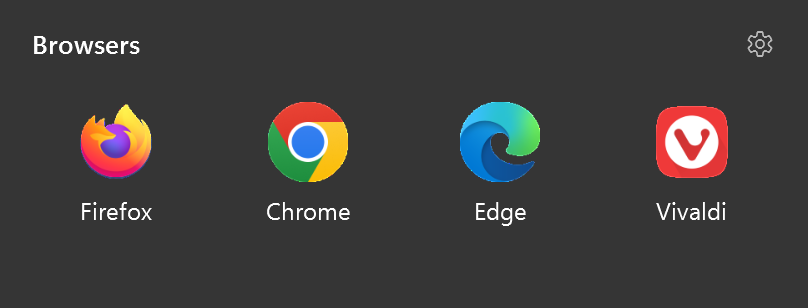
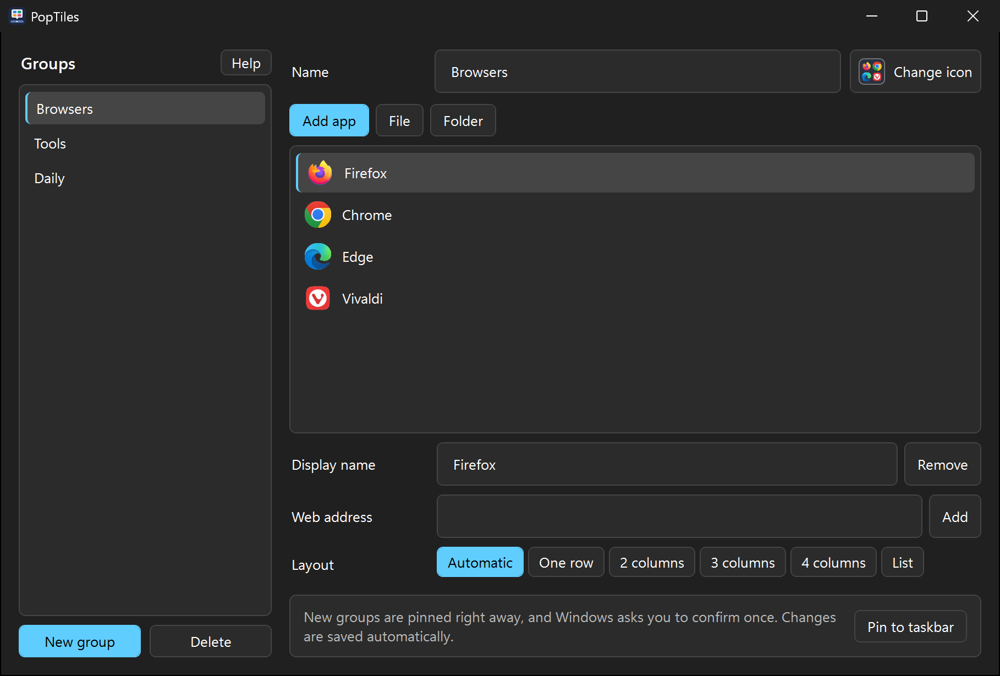
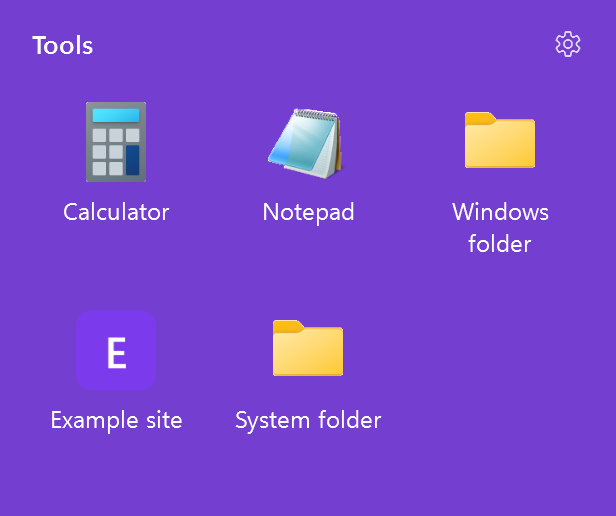
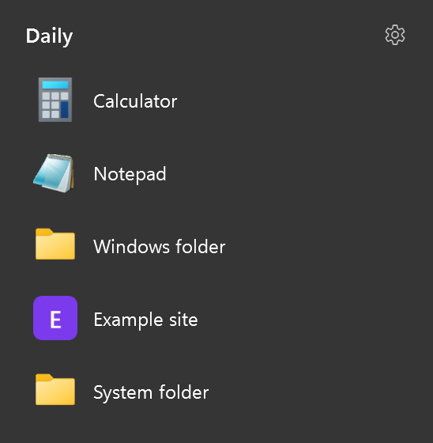
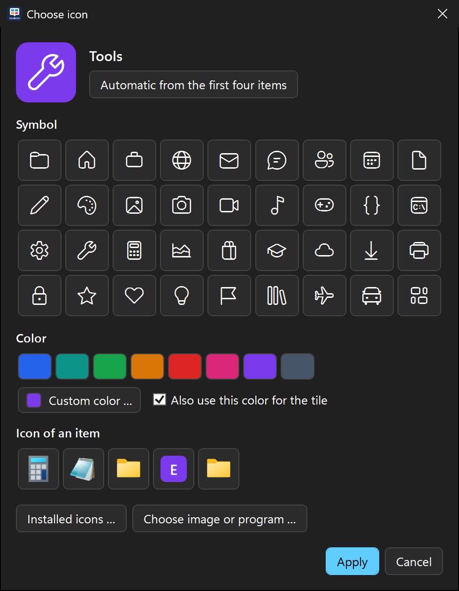

# PopTiles

Groups for your Windows taskbar. Pin a group, click it, and a tile with its apps pops up right above the taskbar.

PopTiles keeps your taskbar tidy by putting apps, games, files, folders and websites behind a single icon.

<p align="center">
  
</p>

## Screenshots

<p align="center">
  
</p>

<table>
  <tr>
    <td align="center"><br>Tile in the group color</td>
    <td align="center"><br>List layout</td>
    <td align="center"><br>Icon and color picker</td>
  </tr>
</table>

On Windows 11, tiles have a translucent background that picks up what's behind them.

## Features

- **Groups on the taskbar:** Each group gets its own pinned icon and opens its own tile.
- **Quick setup:** Create a group, confirm the Windows prompt, done. Deleting a group also tries to unpin its icon.
- **Everything in one place:** Add apps (including Microsoft Store apps), games, files, folders and web addresses.
- **Game stores:** Finds games from Steam, Ubisoft Connect, Epic Games and GOG, even without a Start menu entry.
- **Your own look:** Choose a symbol, a color, an installed icon or your own image. By default, the icon previews the first four items.
- **Colored tiles:** Optionally use the group color for the tile. Text switches to dark on light colors.
- **Flexible layout:** Automatic, one row, 2 to 4 columns, or a list.
- **Drag and drop:** Reorder items by dragging them, or drop files and shortcuts into the list.
- **Five languages:** English, German, French, Spanish and Italian, chosen automatically from your Windows display language. Other languages fall back to English.
- **Light and dark mode:** Follows your Windows theme.
- **Lightweight:** No background process and no autostart. PopTiles only runs while a tile or the editor is open.
- **Private:** No account, no telemetry and no network requests by PopTiles itself.

## Download and installation

1. Download `PopTiles-Setup-<version>.exe` from the [latest release](../../releases/latest).
2. Run the installer. You don't need administrator rights.
3. Open PopTiles from the Start menu.

PopTiles is installed for the current Windows user only, always in `%LOCALAPPDATA%\Programs\PopTiles`. The folder can't be changed because PopTiles stores your groups next to the program and needs write access there.

## ⚠️ Windows SmartScreen warning

**The installer is not code-signed yet, so Windows will probably warn you when you run it.** You may see "Windows protected your PC". This warning appears for many new programs from independent developers without an established reputation. It doesn't mean that a virus was found, but it also doesn't prove that a file is safe.

Only continue if you trust the source:

1. Make sure you downloaded the installer from this repository's [Releases](../../releases) page.
2. Optionally compare its checksum with the one listed in the release notes:

   ```powershell
   Get-FileHash .\PopTiles-Setup-1.0.0.exe -Algorithm SHA256
   ```

3. In the warning, click **More info**, then **Run anyway**.

You can also review the source code and build the installer yourself, as described below.

## Using PopTiles

1. Click **New group**, enter a name and click **Create**.
2. Windows asks at the bottom right whether the group should be pinned to the taskbar. Click **Yes**. This can take a few seconds.
3. Add items with **Add app**, **File**, **Folder** or **Web address**, or drag files and shortcuts into the list.
4. Click the group icon in the taskbar to open its tile, then click an item to start it.

Click next to the tile or press **Esc** to close it. The gear in the tile opens the editor, where **Help** shows the full guide.

## Good to know

- **Windows requires a confirmation for pinning.** Apps can't pin themselves silently, so one click per group is needed. Windows notifications must be turned on for the prompt to appear.
- **Groups only start programs.** A running program still gets its own taskbar icon.
- **Unpinning uses the standard Windows command.** If it doesn't work, PopTiles tells you. Right-click the icon in the taskbar to unpin it.
- **Renaming:** A pinned icon may keep its old name until you pin the group again.
- **Icons:** If the taskbar still shows an old icon after a change, sign out of Windows and back in.
- **Websites** get a letter tile, because PopTiles doesn't download website icons.

## Supported game stores

| Store | How games are found | Tested |
|---|---|---|
| Steam | Windows list of installed programs | Listed and added, not launched yet |
| Ubisoft Connect | Windows list of installed programs | Listed and added, not launched yet |
| Epic Games | Epic's local game files | Listed, not launched yet |
| GOG | GOG's registry entries, including launch parameters | Listed, not launched yet |
| EA | Windows list of installed programs | Not tested with an installed game |
| Battle.net | Windows list of installed programs | Not tested with an installed game |

Any other program can be added with **File**. Bug reports and test results are welcome.

## Requirements and project status

- **Windows 11.** PopTiles was developed and tested on Windows 11 25H2, so far on a single PC.
- **Windows 10** may work, but it's untested and has no transparent tile background.
- **.NET Framework 4.8**, which is included in Windows 11.
- **Automatic pinning** needs a current Windows version. If Windows doesn't allow it, PopTiles offers to show the shortcut so you can pin it yourself.
- The French, Spanish and Italian translations haven't been reviewed by native speakers yet.

PopTiles is an early release. Please [open an issue](../../issues) if something doesn't work.

## Your data

| What | Where |
|---|---|
| Program, groups, group icons and a small log of pin attempts | `%LOCALAPPDATA%\Programs\PopTiles` |
| Start menu entries | `PopTiles` folder in your Start menu |
| Pinned group icons | Your Windows taskbar settings |

To list your apps and games, PopTiles reads the Start menu, the Windows list of installed programs, and the local data of Epic Games and GOG. This information stays on your PC.

## Uninstalling

Open **Windows Settings > Apps > Installed apps** and uninstall PopTiles. You'll be asked whether to delete your groups as well. Unpin any remaining group icons from the taskbar.

## Building from source

You need Windows and the [.NET SDK](https://dotnet.microsoft.com/download).

```powershell
# Builds the program to .\dist
.\build.ps1

# Also builds the installer to .\installer\output
.\build-installer.ps1
```

The installer is built with Inno Setup, which is downloaded as a NuGet package and isn't installed on your system.

## License

Copyright (C) 2026 PopTiles contributors

PopTiles is free software, released under the [GNU General Public License v3.0](LICENSE). You can use, change and pass it on. If you distribute it or a modified version, you must make the corresponding source code available under the same license.

PopTiles comes with **absolutely no warranty**, to the extent permitted by applicable law. See sections 15 and 16 of the license.

The installer is created with [Inno Setup](https://jrsoftware.org/isinfo.php), Copyright (C) 1997-2026 Jordan Russell and Portions Copyright (C) 2000-2026 Martijn Laan, which has its own license and is not covered by the GPL.

PopTiles is an independent project and isn't affiliated with or endorsed by Microsoft, Valve, Ubisoft, Epic Games, GOG, Electronic Arts or Blizzard. All product names and trademarks belong to their respective owners.
